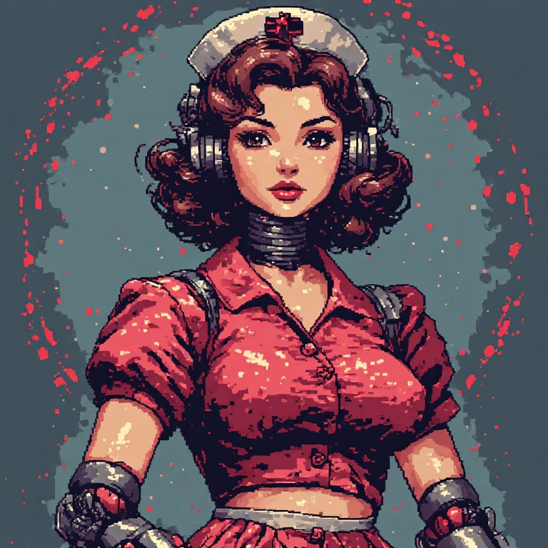
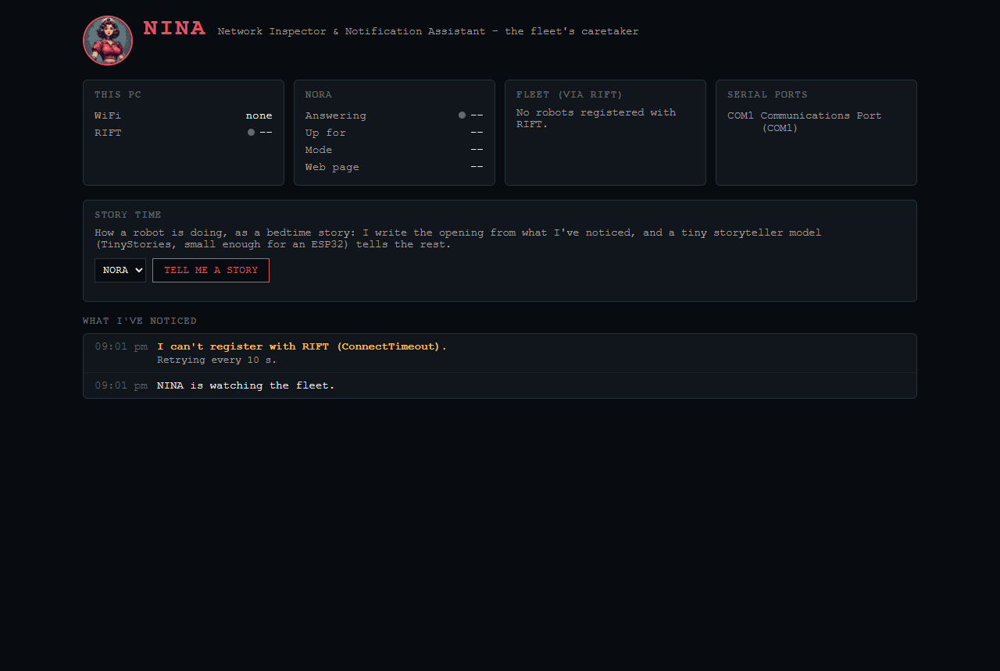

<p align="center"></p>

<h1 align="center">NINA</h1>
<h3 align="center">Network Inspector & Notification Assistant</h3>
<p align="center"><i>A DREAM Robotics Caretaker</i></p>

<div align="center">

[](https://x.com/NorowaretaGemu) [](https://opensource.org/licenses/MIT)

</div>

<div align="center">
  <a href="https://ko-fi.com/cursedentertainment">
    
  </a>
</div>

<div align="center">
  
  
  
</div>

---

- Robot Type: Caretaker (software, runs on the PC beside RIFT)

<div align="center">
  
  <p><i>NINA</i></p>
</div>

**Site:** [cursedprograms.github.io/NINA](https://cursedprograms.github.io/NINA/)

The fleet's caretaker. NINA watches every robot and says what's wrong, and why, before you have to go looking.

---

<div align="center">
  
</div>

**Windows app:** [`builds/NINA-Controller.exe`](builds/NINA-Controller.exe) opens NINA's page in a window and starts `run.bat` if she isn't running. Keep it in `builds/`. Source: `scripts/web_controller`.

---

**IR reader:** read a remote's button codes from her page, through an Arduino on this PC with an IR receiver wired to it. Pick the port and press START READING. FLASH THE READER puts `scripts/ir_reader` on the board first, with the receiver on pin 6, A3 (MILA, NIKA) or 11 (IDA). It replaces what's on that board, so it asks first, and only this PC can do it.

**Handshake:** NINA uses the fleet's `WHO` handshake, in `board_id.py`, the same as ARM and DREAM. Her reader answers `I am Nina`, so her page shows when the board's really talking to her. WHO'S THERE asks every free board and shows which is which, such as ARM's and DREAM's. Opening a port resets its Arduino, so NINA never does that by herself, only when you press it.

## Related Projects


<table>
  <tr>
    <td align="center"><a href="https://github.com/CursedPrograms/ARIA-Robot-v00"><br>ARIA</a></td>
    <td align="center"><a href="https://github.com/CursedPrograms/KIDA-Robot-v01"><br>KIDA-01</a></td>
    <td align="center"><a href="https://github.com/CursedPrograms/KIDA-Robot-v00"><br>KIDA-00</a></td>
    <td align="center"><a href="https://github.com/CursedPrograms/WHIP-Robot-v00"><br>WHIP</a></td>
    <td align="center"><a href="https://github.com/CursedPrograms/NORA-Robot-v00"><br>NORA</a></td>
    <td align="center"><a href="https://github.com/CursedPrograms/MILA-Robot-v00"><br>MILA</a></td>
    <td align="center"><a href="https://github.com/CursedPrograms/NIKA-Robot-v00"><br>NIKA</a></td>
  </tr>
  <tr>
    <td align="center"><a href="https://github.com/CursedPrograms/IDA-Robot-v00"><br>IDA</a></td>
    <td align="center"><a href="https://github.com/CursedPrograms/ARM-Robot-v01"><br>ARM</a></td>
    <td align="center"><a href="https://github.com/CursedPrograms/DREAM"><br>DREAM</a></td>
    <td align="center"><a href="https://github.com/CursedPrograms/RIFT"><br>RIFT</a></td>
    <td align="center"><a href="https://github.com/CursedPrograms/RITA"><br>RITA</a></td>
    <td align="center"><a href="https://github.com/CursedPrograms/TINA"><br>TINA</a></td>
  </tr>
</table>

---

## What she watches

| | What | Why |
| :--- | :--- | :--- |
| **Fleet** | Every robot RIFT knows (`GET /fleet`): answering or not, and how fast | Two misses in a row = offline; she says when it's back |
| **NORA** | Her web server's speed, her uptime (`/talk` `now`), her drive mode and who changed it (`/sensors` `mode` + `msrc`) | A slow page freezes NORA's whole loop; uptime falling back means she rebooted (a power dip?); a mode change nobody made gets flagged |
| **This PC** | Which WiFi it's on | NORA "offline" often just means Windows hopped back to a network with internet |
| **Serial ports** | Ports appearing and disappearing, with a guess at which board it is | Listed only, **never opened**: opening a port resets an Arduino and fights the program that owns it |

Everything goes to her log. She says the important things out loud (Windows text-to-speech) and writes them to RIFT's mission log.
She also keeps [TINA](https://github.com/CursedPrograms/TINA), the fleet's engineer, in the picture: everything she notices as it happens, and a snapshot of the fleet every 30 s, so TINA starts every job knowing the fleet.

### Checkups

NINA asks every robot how it is: **moving or standing still, turning, wheels locked, playing music, its mode**,
from its own status page (NORA's `/sensors`, MILA's and the others' `/status`) or from readings the robot sends her
(`POST /report {"name", "state": {...}, "sensors": {"front": 23.5}}`). `GET /checkups` shows what each one says.

She also watches their distance sensors. One that reads nothing (0, -1, 999) or exactly the same value for
`StuckMinutes` gets a checkup, like a doctor's:

1. *"MILA, are you standing still?"*
2. **Moving**, yet the reading never changes: the sensor is stuck - she tells you, out loud.
3. **Standing still**: she moves it a little (forward for a front/back sensor, a small turn for a side one),
   measures again, and moves it back. Changed = healthy, it was only parked. Unchanged = she tells you.
4. **Can't tell, or can't move it**: she says what she saw and what would let her test it.

She only moves a robot that is standing still in manual mode, and only with the key you give her in
`Passwords` (NORA's wheel-lock password, MILA's and WHIP's PINs). Without it she never moves anyone.

**A robot in distress.** She also watches for a robot in trouble, and only warns you, out loud and in the mission log: she never stops a robot herself. A robot moving nonstop for `DistressMinutes`, turning in nearly every reading for `PanicMinutes` (bouncing off walls), or moving while another robot's radio stays right on top of it for `GluedMinutes` (stronger than -35 dBm in RIFT's `/near`: something stuck to it, like RITA glued onto NORA). The same warning waits 30 minutes before she says it again. Lock the robot with RIFT's **Lock all**, or its own lock.

---

## Running

```bat
run.bat
```

`run.bat` sets up `venv` the first time, then starts NINA. Her page is at **http://127.0.0.1:5012/**.

She registers with RIFT every 10 s (`type: caretaker`, `web:5012`, `talk:5012`), so she shows up on RIFT's dashboard and in MILA's fleet list, and joins the Brainfuck conversations (`GET /chirp?u=0-13` beeps the phrase on the PC speaker, in her own pitch).

---

## Settings

`options.bat` opens the options menu (the same one every bot has) for `config.json`:

| Setting | Default | |
| :--- | :--- | :--- |
| `Port` | `5012` | her page and API |
| `RiftHost` / `RiftPort` | `127.0.0.1` / `5000` | where RIFT runs |
| `NoraHost` / `NoraSsid` | `192.168.4.1` / `NORA` | NORA's address and WiFi name |
| `CheckSeconds` | `5` | how often she looks |
| `SlowMs` | `2000` | slower than this is worth a warning |
| `Speak` / `Voice` / `VoicePitch` | on / Zira / `0.85` | her voice and her chirp pitch |
| `MissionLog` | on | write problems to RIFT's mission log |
| `TinaUrl` | `http://127.0.0.1:5013` | where TINA is, for her fleet news |
| `StuckMinutes` | `10` | a sensor on one value this long gets a checkup |
| `DistressMinutes` | `15` | a robot moving nonstop this long: she warns you (`0` = off) |
| `PanicMinutes` | `3` | turning in nearly every reading this long (bouncing off walls): she warns you |
| `GluedMinutes` | `5` | another robot's radio right on top of a moving one this long: she warns you |
| `Passwords` | empty | `NORA` / `MILA` / `WHIP` keys, so she may move them a little to test a sensor |

---

## API

- `GET /status`: everything she knows (robots, NORA, WiFi, ports, recent events)
- `GET /events`: her log, newest first
- `GET /ping`, `GET /chirp?u=0-13`

---

## Colours

Her colours come from her avatar (`colour_scheme.xml`): slate blue-grey surfaces, her red-cross red as the accent, her crimson dress and a warm cream. Her page, her options menu and the site all use them.

---

<div align="center">&copy; Cursed Entertainment 2026</div>

<div align="center">
  <a href="https://cursed-entertainment.itch.io/">
    
  </a>
</div>

---

<!-- DREAM-ECOSYSTEM:START -->
## The DREAM Robotics ecosystem

**Minds** — [DREAM](https://github.com/CursedPrograms/DREAM) companion · [TINA](https://github.com/CursedPrograms/TINA) engineer · [NINA](https://github.com/CursedPrograms/NINA) caretaker · [RIFT](https://github.com/CursedPrograms/RIFT) fleet hub · [LYCEA](https://github.com/CursedPrograms/LYCEA) training school  
**Robots** — [NORA](https://github.com/CursedPrograms/NORA-Robot-v00) · [MILA](https://github.com/CursedPrograms/MILA-Robot-v00) · [WHIP](https://github.com/CursedPrograms/WHIP-Robot-v00) · [KIDA-00](https://github.com/CursedPrograms/KIDA-Robot-v00) · [KIDA-01](https://github.com/CursedPrograms/KIDA-Robot-v01) · [IDA](https://github.com/CursedPrograms/IDA-Robot-v00) · [ARM](https://github.com/CursedPrograms/ARM-Robot-v01) · [NIKA](https://github.com/CursedPrograms/NIKA-Robot-v00) · [ARIA](https://github.com/CursedPrograms/ARIA-Robot-v00)  
**Remotes** — [RITA](https://github.com/CursedPrograms/RITA) handheld remote  
<!-- DREAM-ECOSYSTEM:END -->
